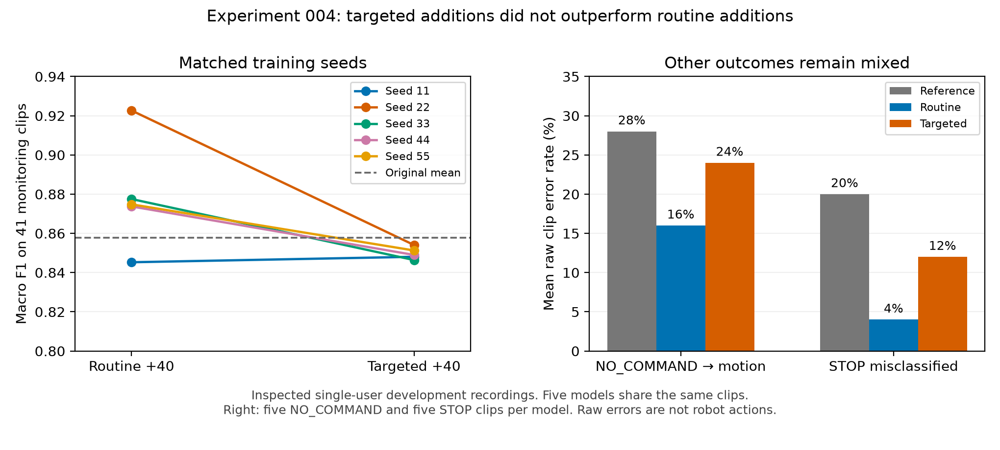

# Experiment 004: routine additions outperformed targeted additions in this pilot

> Git-tracked records: [configuration, results and provenance](../results/004_boundary_data/README.md). Original run/data links below require the local private archives.

Date: 2026-10-08 (America/Chicago). Study `20261008T072040903427Z`.
**Inspected single-user development validation; no final test or robot outcome.**

## Question and controlled procedure

At the same additional training-label budget, do examples focused on observed
confusions help more than additional familiar-style examples? The plan was fixed
before collection/fitting in `BOUNDARY_DATA_PLAN.md` and `PROTOCOL.md`.

Both new conditions contain the same 472 base training clips plus 40 additions:
10 FORWARD, 10 BACKWARD, 10 NO_COMMAND and 10 DOWN. Routine asks for usual
comfortable gestures; targeted asks for resting/repositioning versus deliberate
DOWN and more varied clear beckoning versus pushing away. Both groups occur in
both new training sittings, reversing group order in sitting 2. This bundles
instruction/style/coverage differences, not one isolated causal factor or random
data acquisition. The existing five 472-label models are a smaller-budget
reference, not an equal-label competitor.

New collection: 80 clips in capture sessions `20261008T063028-1f0a4f92` and
`20261008T065105-55ca7759`, 40 each. Task/group provenance, tracking and uniqueness
checks pass. Hand identity is reported as unspecified; individual style
compliance cannot be established from task prompts/tracking alone. Original
560 development inputs and original checkpoint hashes remain unchanged.

Each new condition uses 512 clips, class counts 124/85/68/59/57/61/24/34 in
FORWARD/BACKWARD/LEFT/RIGHT/STOP/NO_COMMAND/UP/DOWN order. Same existing 67-feature
preprocessing and 48,520-parameter temporal CNN; fresh weights per seed
11/22/33/44/55, weighted CE, Adam .001, 560 updates, replacement batches of 32,
no augmentation and 28 checkpoint checks. Base row order is preserved; additions
align by class/sitting/repeat. Initial weights, class counts and batch-index
streams match exactly within each routine/targeted seed pair.

Only original 47 v2 validation clips select weights. The second 41-clip session
supplies separate monitoring results after weight selection; it never enters
gradient updates or selection loss. Both sessions already informed development,
so neither is untouched final test. All ten new candidates and five exact
reference copies are retained. No best seed, ensemble, threshold or live model
activation is selected.

## Primary and overall outcomes

| Condition | Training labels | Selection accuracy / 47 | Monitoring accuracy / 41 | Monitoring macro F1 | Monitoring NLL |
| --- | ---: | ---: | ---: | ---: | ---: |
| Original reference | 472 | 85.11% | 86.34% ±4.43 pp | 0.8577 ±0.0447 | 0.4690 |
| Routine +40 | 512 | 87.66% | 88.29% ±2.67 pp | 0.8788 ±0.0278 | 0.2671 |
| Targeted +40 | 512 | 86.38% | 85.37% ±0.00 pp | 0.8497 ±0.0030 | 0.3439 |

Spreads are run SD across five models on shared recordings, not population
confidence intervals. Targeted models each get 35/41 correct, but differ in
errors/weights and macro F1; identical accuracy does not mean identical models.
Routine models get 35/38/36/36/36 correct. Reference gets 37/37/34/36/33.

**Prespecified primary comparison: targeted minus routine mean monitoring
macro F1 = −0.02905.** Per-seed differences 11/22/33/44/55:
+0.00278 / −0.06862 / −0.03113 / −0.02475 / −0.02353. Targeted is lower in
four of five paired runs. The expected targeted advantage did not appear here.
This does not establish that targeted collection is generally harmful.

Routine monitoring accuracy is 1.95 percentage points above reference; targeted
is 0.98 points below reference and 2.93 below routine. These are descriptive
small-session differences: routine averages only 0.8 more correct clips/model
than reference. NLL is lower in both added conditions; lower probability loss
does not by itself establish calibrated scores or reliable robot execution.

| Seed | Routine accuracy | Targeted accuracy | Routine macro F1 | Targeted macro F1 | Saved step routine / targeted |
| ---: | ---: | ---: | ---: | ---: | ---: |
| 11 | 85.37% | 85.37% | 0.8453 | 0.8480 | 400 / 400 |
| 22 | 92.68% | 85.37% | 0.9227 | 0.8540 | 540 / 420 |
| 33 | 87.80% | 85.37% | 0.8775 | 0.8464 | 460 / 560 |
| 44 | 87.80% | 85.37% | 0.8737 | 0.8490 | 500 / 360 |
| 55 | 87.80% | 85.37% | 0.8748 | 0.8513 | 360 / 360 |

## Class results and regressions

Each class has five monitoring clips, except RIGHT six. Means reuse those same
clips across the five models; they do not create five times as many human samples.

| True class | Reference recall | Routine recall | Targeted recall |
| --- | ---: | ---: | ---: |
| FORWARD | 64% | 64% | 60% |
| BACKWARD | 96% | 88% | 84% |
| LEFT | 96% | 100% | 100% |
| RIGHT | 96.67% | 100% | 93.33% |
| STOP | 80% | 96% | 88% |
| NO_COMMAND | 72% | 84% | 76% |
| UP | 84% | 72% | 80% |
| DOWN | 100% | 100% | 100% |

Routine helps STOP/NO_COMMAND on this session, but BACKWARD and UP are lower
than reference and FORWARD is unchanged. Targeted leaves FORWARD/BACKWARD weak.
Perfect small-pool recall does not establish general recognition reliability.
DOWN mean precision is 80.95% / 93.33% / 83.33% for reference/routine/targeted,
despite 100% recall in all three.

Raw NO_COMMAND→all-motion means are 28% / 16% / 24%; NO_COMMAND→DOWN means
24% / 8% / 20%. Raw STOP→motion counts across repeated model–clip predictions
are four / one / one. Routine has nine FORWARD→BACKWARD and three reverse errors;
targeted has ten and four respectively. Full confusion matrices are retained.
These repeated predictions are not independent physical events or false starts
per minute. No score/margin/repeat gate or continuous stream was simulated.

## Original shared error corrected, other errors remain

Exploratory inspection after the primary metrics: all ten new models classify
the user-confirmed resting NO_COMMAND clip `7601353c641440f9bca0b5c65cfed650.npz`
correctly. Original models all predicted DOWN with scores >.996. New NO_COMMAND
scores range .7478–.9978 for routine and .5691–.9908 for targeted. The label and
recording were never changed or duplicated into training.

Fixing this one case did not solve the class: another NO_COMMAND clip,
`2cf792b82a104d959940e7183c996466.npz`, becomes DOWN in two routine models and
all five targeted models. Preserve its human label; a model guess is not grounds
for relabeling. Its true motion/RGB meaning is not independently diagnosed here.

Post-primary raw STOP/NO_COMMAND→motion score counts ≥.8 / ≥.95 are:
reference 6/5, routine 1/0, targeted 4/1. The maximum targeted false-motion score
is .9952. These are repeated model–clip scores, not executed commands. No
threshold was tuned. Confidence remains insufficient proof of a pseudo-label.
One corrected exemplar does not establish the intended general distinction.

## Effort, verification and limits

New acquisition is **80 usable labels**, plus **16 known discarded saves** from
the requested restart. Each new candidate uses 40 additional labels; the project
did not spend only 40. Completed camera intervals total **34.51 minutes**,
including replay/preparation/pauses, excluding deleted-attempt/offline time.
This is not pure annotation time or total project cost. Inherited labels,
corrections/reviews and prior fitting still count. Mean new fitting time is
3.8461 seconds/routine seed and 3.8260/targeted seed, excluding artifact work,
collection and historical reference training.

Six new meaningful synthetic checks passed before real fitting. Real artifact
verification passed: **640 unchanged input files, 15 checkpoints, 1,320 saved
score vectors**, exact reference reproduction, archived input/source hashes,
paired initial-state/batch-index/class-count hashes, and all result summaries.
These establish software/preservation integrity, not statistical robustness.
No real execution failures occurred; unfavorable outcomes are preserved.

The current evidence favors routine additions for further comparison on these
inspected recordings. It does not justify choosing the best individual seed,
claiming a universally superior acquisition policy, label savings, SSL/stage-
order advantage, unseen-user accuracy, novelty or robot reliability. New data
and a changed pool separate both additions from the reference; only the two
equal-budget added conditions form the primary comparison.

Next proposed phase: freeze a joint comparison/evaluation policy for all declared
candidates, then acquire genuinely new evaluation sessions. Current validation
must not be reused as an untouched final benchmark. No final freeze or test
collection was performed here. Unseen-user and physical-robot experiments remain
separate work; this is landmark-based perception only.

## Files and reproducibility

Artifacts: [`20261008T072040903427Z`](../experiments/runs/boundary_data/20261008T072040903427Z/).

- `collection_plan.json`, `manifest.json`, `config.json`, `contract.json`: the
  prepared policy, all roles/row orders/provenance and training settings.
- `development_features.npz`: base/addition/selection/monitor arrays kept separate.
- `reference/seed_N/model.pt`: exact copies of previously saved weights.
- `routine/seed_N/` and `targeted/seed_N/`: every new weight/history and both
  prediction/metric sets, without overwriting originals or activating the app.
- `environment.json`, `source/`, `verification.json`: versions, actual code,
  hashes and completed preservation/reproduction checks.
- `summary.json`, `trials.json`, `report.md`: all favorable/unfavorable outcomes.
- `exploratory_diagnostics.json`: post-primary shared-error and score inspection.
- `plot_results.py`: standalone figure generation from archived results, using
  existing Matplotlib3.11.2; no fitting or additional dependencies.

Teaching explanation: [Lesson 6](../LESSON_06.md). A normal rerun creates another
study; it supplies no independent evidence on these same inspected recordings.
