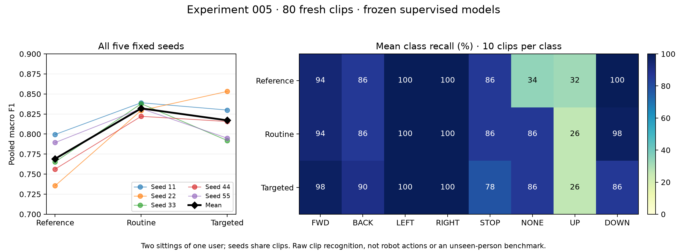

# Experiment 005 — fresh frozen test: routine leads; UP recognition remains weak

> Git-tracked records: [configuration, results and provenance](../results/005_boundary_test/README.md). Original run/data links below require the local private archives.

**2026-10-12 clarification:** The user says intended STOP was an open palm, while
the recorded English contract/prompts said closed fist. The user subsequently
reported "yes almost all were open palm, no fists"; this is a qualified human
report, not independent review of every recording. This is a protocol/semantic
discrepancy that limits interpretation; keep the original metrics and sources,
do not silently relabel samples or describe them as verified fist gestures.
The user proposes a narrower replacement UP definition for a new data version;
that future task is not directly the same broad UP movement task tested here.

Executed 2026-10-08 after both new sittings finished. The comparison, 15 candidate
weights and recording schedule were fixed before these recordings existed.
Protocol: [test plan](../BOUNDARY_TEST_PLAN.md); frozen record:
`../experiments/data/boundary_test/freeze.json`, SHA256
`ab96e006890a4b6e3d032e76d3d5ee402a19b13f19cb218095f5619043d02398`.

## Data and execution

80 fresh human-labeled clips, five per each of eight classes per physical sitting.
Same current user, two sittings; these are not unseen-person benchmark data.
Sitting 1 has two capture sessions because the camera stopped after 20 clips:
`20261008T164636-0a26e7aa` and `20261008T171301-18937971`, 20 each. Sitting 2:
`20261008T173315-7a4cd252`, 40 clips. Keep the two sitting-1 capture IDs together.
Metadata provenance passes; it does not independently verify physical conditions
or gesture intention. Each sitting has every label and the same prescribed style
mix; pooled results describe this balanced sample, not deployment frequencies.

All 15 frozen checkpoints were scored together, without retraining, threshold
changes, ensemble, seed selection or camera activation. Test access was recorded
before landmark payloads. Evaluation completed successfully. These clips are
now inspected; they cannot become an untouched future benchmark.

Two tracking-quality failures were retained: the prescribed no-hand NO_COMMAND
clip in each sitting. All models classify these as NO_COMMAND. No clipping of
poor results or exclusion of tracking failures occurred. No exact raw duplicates
of known development inputs or other new clips were found.

## Prespecified pooled outcomes

Mean over seeds 11/22/33/44/55; SD measures training variation on shared clips.

| Condition | Training clips/model | Accuracy mean ± seed SD | Macro F1 mean ± seed SD | NLL mean |
| --- | ---: | ---: | ---: | ---: |
| Original reference | 472 | 79.00% ± 2.40 pp | .7692 ± .0257 | .9992 |
| Routine additions | 512 | 84.50% ± .68 pp | .8320 ± .0069 | .4956 |
| Targeted additions | 512 | 83.00% ± 2.09 pp | .8171 ± .0255 | .4963 |

Primary targeted-minus-routine macro F1: **−.01492094** averaged over paired seeds.
Seed differences: 11 −.00910102; 22 +.02370089; 33 −.04589897;
44 −.00641274; 55 −.03689285. Four of five favor routine. The expected targeted
advantage is not supported on this test; do not conceal the favorable seed 22 or
choose it as the deployed winner. This is a descriptive pilot, not a statistical
population superiority claim.

Routine improves mean accuracy 5.5 percentage points over reference (4.4 more
correct clips per model out of 80); targeted improves 4 points (3.2 more).
Routine and targeted are label-count/recipe matched. Reference uses fewer
training labels, so this is not a demonstration of label savings.

| Seed | Reference correct/80 | Routine correct/80 | Targeted correct/80 |
| --- | ---: | ---: | ---: |
| 11 | 65 | 68 | 67 |
| 22 | 60 | 67 | 69 |
| 33 | 64 | 68 | 65 |
| 44 | 63 | 67 | 66 |
| 55 | 64 | 68 | 65 |

| Sitting | Reference accuracy / F1 | Routine accuracy / F1 | Targeted accuracy / F1 |
| --- | ---: | ---: | ---: |
| 1, 40 clips | 81.5% / .7973 | 87.0% / .8636 | 87.0% / .8626 |
| 2, 40 clips | 76.5% / .7369 | 82.0% / .7933 | 79.0% / .7638 |

Sitting 2 is lower for all conditions. This does not identify the cause or prove
independent sampling. Keep its unfavorable result rather than selecting sitting 1.

## Class behavior and robot-command implications

Recall means the proportion of actual examples recognized correctly, averaged
over seeds. Every class has ten unique clips; repeated model predictions are
not extra independent observations.

| Actual class | Reference recall | Routine recall | Targeted recall |
| --- | ---: | ---: | ---: |
| FORWARD | 94% | 94% | 98% |
| BACKWARD | 86% | 86% | 90% |
| LEFT | 100% | 100% | 100% |
| RIGHT | 100% | 100% | 100% |
| STOP | 86% | 86% | 78% |
| NO_COMMAND | 34% | 86% | 86% |
| UP | 32% | 26% | 26% |
| DOWN | 100% | 98% | 86% |

NO_COMMAND-to-motion errors drop from 66% reference to 14% for either added
condition. NO_COMMAND-to-DOWN is 60%/10%/8% respectively. This is a meaningful
sample-specific improvement, but not zero false movement recognition.
STOP-to-motion rates are 10%/14%/14%; STOP recall is 86%/86%/78%.
Targeted loses STOP and DOWN recall while improving FORWARD/BACKWARD. Routine
loses UP recall. Neither condition solves all command classes.

Mean DOWN precision is 60.38%/86.90%/92.05%, whereas mean STOP precision is
55.78%/53.46%/51.17%. The low STOP precision is mostly because UP is called STOP:
34/50, 37/50 and 37/50 repeated UP model predictions, respectively. An average
accuracy can therefore hide a consistently missed intended direction.

No physical robot actions occurred. These are raw recognition errors, not
measured motor activations, continuous false commands per minute, live-gate
acceptance, emergency-stop reliability or drone/medical-robot performance.

## Exploratory inspection after the primary calculation

Saved prediction rows grouped by the planned UP style show:

- One-finger upward pointing: 9/10 repeated predictions correct for reference,
  8/10 each for routine and targeted.
- Several-finger pointing: 7/10 reference, 5/10 each added condition.
- Whole-hand upward motion (two styles/repeats) and angled upward pointing:
  every prediction is STOP for all three conditions and every seed. This covers
  six unique UP clips, not 90 independent failures.

These are prompt-based groups, not independently verified actual performed
styles. A training-coverage, representation or recording issue is a hypothesis;
the result alone does not establish its cause. The original reference also fails
these styles, so additional F/B/NONE/DOWN examples did not create the entire UP
problem. Do not automatically relabel the UP clips as STOP because models agree.

Post-primary raw false-motion instances on STOP or NO_COMMAND, across shared
clips and five seeds: reference 38, routine 14, targeted 14. Instances with score
≥.8: 34/7/7; with score ≥.95: 32/4/3. Maximum wrong scores:
.9999939/.9996859/.9942541. Scores are not verified probabilities of correctness;
these counts do not evaluate the live multi-window gate. Confidence-only
pseudo-labeling could retain errors. No threshold was tuned from this inspection.

## Cost and integrity

80 evaluation labels, separate from experiment004's 80 additional training labels
and 16 discarded saves. Camera attempt intervals for this test total
3751.27 seconds = 62.52 minutes, including replay/preparation/pauses. Sitting 1
has two intervals because of the interruption; offline restart time and unsaved
repeat effort are not fully accounted for. No fitting in this phase; all upstream
training, validation, corrections and pretraining remain costs of the project.

`experiments/report_boundary_test.py` verifies original artifact fingerprints,
80 raw recording fingerprints, all 15 model memberships/checkpoint identities,
all **1200 saved score vectors** reproduced from archived features, class names,
pooled/per-sitting metrics, primary aggregation and the one completed access
ledger. This is artifact reproduction, not a second raw-data test access or new
model selection. The frozen evaluator and prior recordings/weights stay unchanged.

Artifacts are in `experiments/data/boundary_test/evaluation/`: original manifest,
features, every candidate's predictions/metrics, trials, summary and costs.
`analysis/` contains verification and explicitly exploratory diagnostics, plus
derived fingerprints. No new dependencies. The scientific figure uses the existing
Matplotlib and was visually inspected.

## What follows

The honest result is improved ordinary/no-command recognition with substantial
remaining style-specific UP failures and STOP/DOWN tradeoffs. It is not proof of
novelty, stage-order advantage, label efficiency, unseen-user recognition or robot
reliability. [Lesson8](../LESSON_08.md) explains how to read this result.

Next diagnose UP/STOP using existing development recordings and landmark motion,
preserving all current labels and models. Do not collect another large batch or
retrain on these test clips by default. The later cost-matched supervised/SSL/
audited-SSL comparison needs its own development pool and a genuinely untouched
benchmark after algorithm choices freeze. Test observations can guide hypotheses,
but these sessions are now inspected forever.
