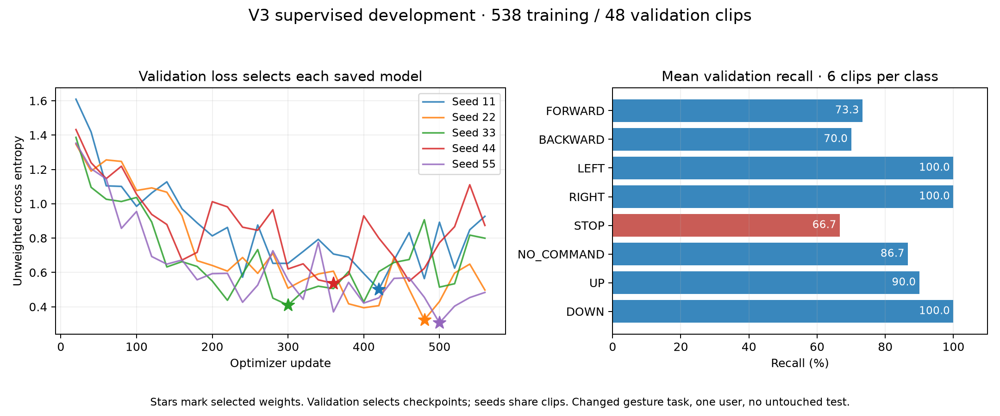

# Experiment 006 — revised UP/STOP contract, supervised v3 development

> Git-tracked records: [configuration, results and provenance](../results/006_commands_v3/README.md). Original run/data links below require the local private archives.

Completed 2026-10-12. New study:
`../experiments/runs/commands_v3/20261012T205727638067Z`.
All previous recordings/checkpoints and unfavorable results preserved; no model
activated in the camera and no final test recorded/evaluated for v3.

## Data and meanings

538 training clips: FORWARD124/BACKWARD85/LEFT68/RIGHT59/STOP57/NO_COMMAND61/
UP50/DOWN34. The old24 UP examples are excluded from the new version. New UP
allows index finger, index+middle fingers or thumb pointing upward, remaining
fingers folded, held deliberately about2s. Prompted training variants17/17/16
across two25-clip sittings. The previous broadly defined open-hand UP motion
task is not the same task as this new definition.

STOP is an open palm facing the camera, fingers extended. User reports earlier
STOP was "yes almost all were open palm, no fists"; reused57 on this qualified
human report without independent per-clip shape verification. The earlier English
closed-fist contract was an incorrect assumption, kept in the historical record.

48 fresh development validation clips from capture session
`20261012T203344-955c84cd`: six/class, UP2/each shape. All538 train inputs and
the contract were pinned before this collection. One legitimate no-hand NONE
tracking failure remains in the denominator; no other validation tracking failure
and no raw duplicate/session overlap. This is one user's specified style sample,
not an unseen-person or continuous robot-command benchmark.

## Fixed fitting procedure

New random initialization for each seed11/22/33/44/55. Same32×67 feature extractor,
48,520-parameter temporal CNN with8 outputs and prior fixed fitter.560 Adam
updates per seed, lr .001, uniform batches32 sampled with replacement,
class-weighted training cross entropy, no augmentation, two CPU threads.
Unweighted validation loss evaluated without gradients every20 updates (28checks).
Lowest loss determines the saved weights; earliest strict minimum wins ties.
No old temporal model fine-tuned. MediaPipe pretraining remains upstream work.

The48 clips both select checkpoints and provide the scores below. Therefore,
these are checkpoint-selected development scores with selection bias, not an
untouched test. Do not claim v2→v3 algorithmic improvement from different
definitions/datasets, pick only a favorable seed, or overwrite earlier results.

## Outcomes: all five models

| Seed | Correct /48 | Validation accuracy | Macro F1 | Saved update | NONE→motion count /6 | STOP→motion count /6 |
| --- | ---: | ---: | ---: | ---: | ---: | ---: |
| 11 | 41 | 85.42% | .8567 | 420 | 1 | 2 |
| 22 | 42 | 87.50% | .8772 | 480 | 0 | 2 |
| 33 | 42 | 87.50% | .8756 | 300 | 1 | 1 |
| 44 | 40 | 83.33% | .8373 | 360 | 1 | 2 |
| 55 | 41 | 85.42% | .8587 | 500 | 1 | 2 |

Means: **85.83% accuracy** (seed SD1.74pp), **.8611 macro F1** (SD.0163),
NLL.4157 (SD.1031). Seeds share the same48 clips; their spread measures training
variation, not uncertainty across people or independent gestures.

| Class | Mean precision | Mean recall | Mean F1 |
| --- | ---: | ---: | ---: |
| FORWARD | 55.40% | 73.33% | .6300 |
| BACKWARD | 100% | 70% | .8218 |
| LEFT | 82.14% | 100% | .8989 |
| RIGHT | 100% | 100% | 1.0000 |
| STOP | 84% | 66.67% | .7418 |
| NO_COMMAND | 93.81% | 86.67% | .8967 |
| UP | 90.95% | 90% | .8995 |
| DOWN | 100% | 100% | 1.0000 |

Mean NONE→motion13.33%, NONE→DOWN0%; STOP→motion30% with STOP recall66.67%.
Mean BACKWARD→FORWARD count1.8/6; FORWARD→BACKWARD0. FORWARD also spills into
STOP/UP/NONE. LEFT/RIGHT/DOWN's100% recall means success on six clips/class per
model here, not universal directional reliability.

## Shared errors and exploratory inspection

UP results grouped by prompts: index10/10 and index+middle10/10 repeated
predictions correct; thumbs-up7/10 correct and3 LEFT. These are two unique clips
per shape viewed by five models, not ten independent gestures. The angled/
height/distance thumbs-up clip `bda917a4c0f148ab876d11514343287d.npz` supplies
the three LEFT errors. No UP clip was STOP on this validation set. Actual
performed shapes are not independently verified beyond human labeling.

Every model misses the same two STOP clips:

- `31f155fc13db4984b9b5108026540f79.npz`: prompted open-palm STOP at a different
  height, FORWARD in all five models.
- `906b8197e62b4f2d80809490b0cd8028.npz`: prompted open-palm STOP at a modest
  angle, FORWARD in four models, NO_COMMAND in seed33.

The highest wrong STOP→FORWARD score is .9939603. A systematic coverage,
representation, labeling or capture issue is a hypothesis to review; model
agreement does not prove the human STOP label should become FORWARD.
Keep both labels unchanged. This remains a significant command-interface failure
even though UP no longer maps to STOP in these examples.

The repositioning NO_COMMAND clip `ee21e3af784b4c648f9a29f2c1528904.npz` is LEFT
in four models (maximum wrong score.94982). Post-primary false-motion instances
on STOP/NONE across repeated model predictions:13 total,8 score≥.8,4≥.95.
No threshold selected or tuned; this does not measure the live multi-window gate,
motor activations, STOP controller response or robot safety.

## Files, costs and verification

New separate `experiments/commands_v3_train.py` reuses the old fitter/features/
network and adds a strict schema3 loader. Old loaders reject these checkpoints;
wrong STOP/UP contract metadata also fails. No frozen collection/core source was
edited. Four synthetic checks passed in6.144s after adding complete provenance
and minimum-loss equality checks. They test incomplete/foreign-data refusal,
split/feature/no-hand retention, full tiny fitting/contract rejection/source
preservation and tampered-prediction detection; synthetic accuracy is not evidence.

The study saves manifest/roles, both collection plans, feature arrays, source,
config/platform/packages, all weights/histories/guesses/metrics and costs.
Verification passed **586 input fingerprints, five checkpoint fingerprints,
240 reproduced saved score vectors**, every class name/metric/summary and
minimum-loss checkpoint provenance. No failed real training run occurred.

New effort:50 UP training labels,48 validation labels,488 reused training labels
with historical costs retained. Logged camera intervals24.04min UP training and
17.45min validation (41.49min combined), including replay/preparation/pauses;
offline and unsaved-repeat effort incomplete. The five fit loops total25.65s
(about5.13s/seed), excluding other artifact/I/O work and upstream training.
Pretraining, prior corrections, excluded data and earlier experiments are not free.

`exploratory_diagnostics.json` is explicitly post-primary inspection. The
standalone plot source/figure fingerprints are in `derived_artifacts.json`.
Existing Matplotlib used, no dependency added.

## What follows

Read [Lesson10](../LESSON_10.md) for weights/checkpoint selection and interpreting
the result. Review the two shared STOP errors, the thumbs-up angle example and
FORWARD/BACKWARD coverage using existing landmarks and human interpretation
before additional collection or deployment. Preserve labels unless a human
explicitly identifies an actual recording/labeling mistake. Do not blindly
pseudo-label or automatically activate a favorable seed.

The current result does not establish label savings, a new algorithm, success
on the old broad-UP motion task, unseen-user or robot reliability. Validation is
now inspected; a later genuinely new test follows fixed choices, and future
paper-scale algorithm comparisons require matched definitions/budgets and
participant/robot evidence.
